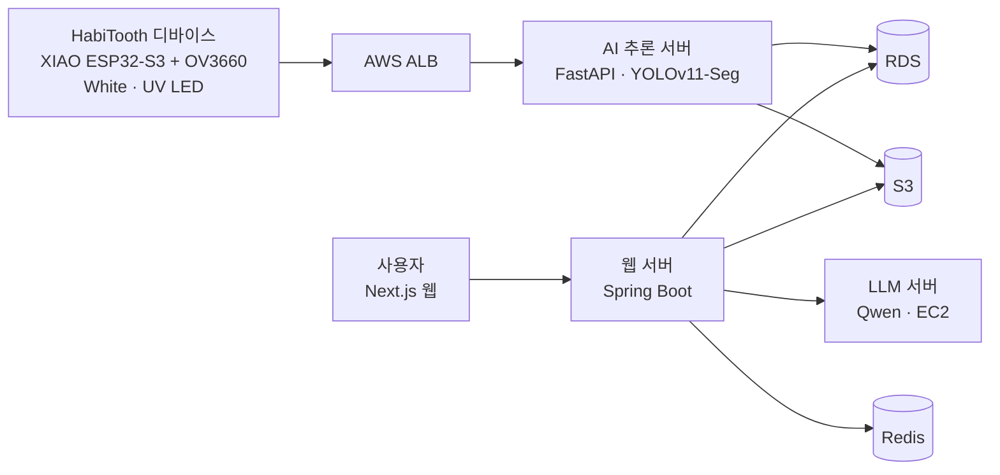
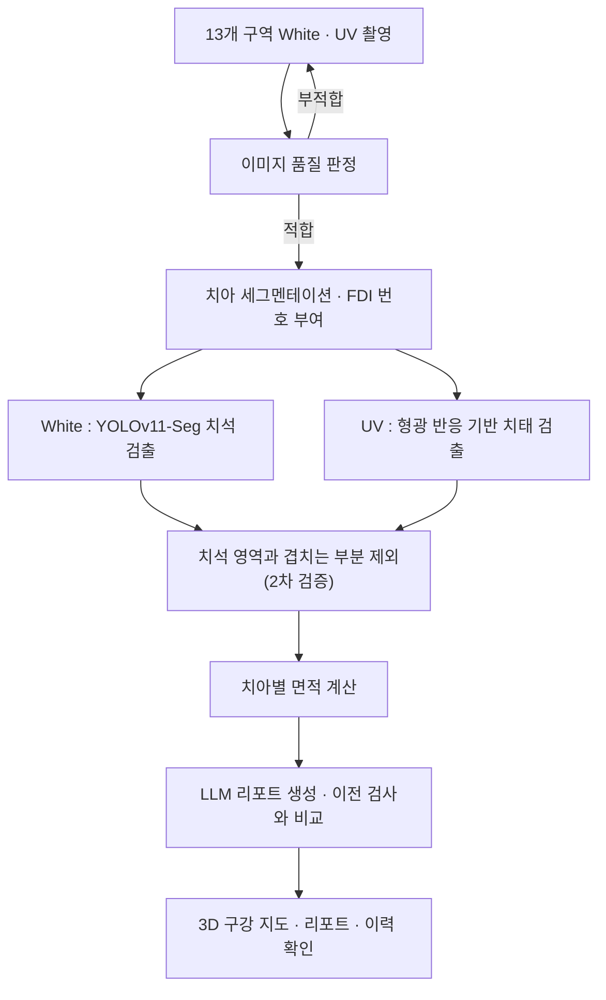

### 오래도록 건강한 내 치아를 위해, HabiTooth
가정용 AI 구강 모니터링 디바이스

    

<br clear="left"/>

## **🦷 1. 프로젝트 개요**

<p align="center">
  
</p>

**1-1. 프로젝트 소개**
- 프로젝트 명 : [HabiTooth] 가정용 AI 구강 모니터링 디바이스
- 프로젝트 정의 : 집에서 백색광·UV 촬영으로 치석과 치태를 확인하고, AI 리포트로 관리 습관을 잡아주는 가정용 구강 모니터링 디바이스
- 서비스 흐름 : 구강 촬영 → AI 분석 → 3D 구강 지도·리포트 확인 → 관리 습관 기록

**1-2. 개발 배경 및 필요성**
- 치태는 꾸준히 관리하면 치석이 되는 것을 예방할 수 있지만, 대부분은 치과에 가야만 내 구강 상태를 알 수 있습니다. 정기 검진 사이의 몇 달 동안은 어디를 잘 못 닦고 있는지 스스로 확인할 방법이 없어 같은 부위에 치태가 계속 쌓이게 됩니다. HabiTooth는 이 공백을 메우기 위해 집에서 직접 촬영하고, 관리가 필요한 부위를 치아 단위로 알려주는 서비스입니다.

**1-3. 프로젝트 특장점**
- 백색광과 405nm UV를 함께 쓰는 이중 광원 촬영으로 치석과 치태를 나눠서 확인
- 백색광 영상은 치석을, UV 영상은 형광 반응이 나타난 치태를 각각 YOLOv11-Seg로 찾은 뒤, 치석 영역과 겹치는 부분을 제외하는 2차 검증으로 둘을 구분
- 치아 세그멘테이션과 규칙 기반 FDI 번호 부여로 결과를 치아 단위로 정리
- 팀이 직접 촬영하고 검수한 백색·UV LED 구강 데이터로 학습
- 지난 검사와 비교해 변화를 짚어주는 LLM 리포트

**1-4. 주요 기능**
<table>
  <tr><th width="140">기능</th><th>설명</th></tr>
  <tr><td>구강 촬영</td><td>손에 쥐고 입안에 넣어 촬영하는 핸드헬드 디바이스로 윗니 안쪽 5개, 아랫니 안쪽 5개, 바깥쪽 3개 구역을 백색광과 UV로 차례대로 촬영합니다. 촬영 버튼을 누르면 두 장이 함께 전송됩니다.</td></tr>
  <tr><td>촬영 품질 확인</td><td>흐리거나 어두운 사진은 서버가 바로 판정해 다시 찍도록 안내합니다.</td></tr>
  <tr><td>AI 분석</td><td>치석과 치태가 쌓인 위치를 찾아 치아별 면적과 구역 점수로 계산합니다.</td></tr>
  <tr><td>3D 구강 시각화</td><td>관리가 필요한 치아를 3D 구강 템플릿 위에서 한눈에 확인합니다.</td></tr>
  <tr><td>AI 리포트</td><td>이전 검사와 비교해 새로 생기거나 계속 남아 있는 부위를 알려주고, 결과에 맞는 관리 방법을 안내합니다.</td></tr>
  <tr><td>기록 관리</td><td>검사 이력을 쌓아 구강 상태의 변화를 추적합니다.</td></tr>
  <tr><td>습관 및 알림</td><td>양치 습관과 연속 기록을 남기고 알림으로 관리를 이어갑니다.</td></tr>
  <tr><td>치아 프로필</td><td>결손치 등 내 치아 정보를 등록해 분석에 반영합니다.</td></tr>
</table>

**1-5. 기대 효과 및 활용 분야**
- 기대 효과
  - 치과에서만 확인할 수 있던 치석·치태 상태를 집에서 확인할 수 있습니다. 고가의 전문 장비 대신 보급형 디바이스로 백색광과 UV를 함께 촬영해, 맨눈으로는 구분하기 어려운 치태까지 나눠서 보여 줍니다.
  - 검진과 검진 사이의 공백을 기록으로 채웁니다. 치아 단위로 쌓인 결과를 이전 검사와 비교해, 어느 부위를 반복해서 놓치는지 사용자가 직접 알 수 있습니다.
  - 확인에서 끝나지 않고 관리로 이어집니다. 리포트의 관리 안내와 습관 기록이 연결되어, 놓치던 부위까지 신경 써서 닦는 습관을 만들 수 있습니다.
- 활용 분야
  - 가족 구강 관리 : 양치가 서툰 아이나 어르신의 구강 상태를 보호자가 대신 촬영해 확인
  - 교정 중인 사용자 : 장치 주변처럼 관리가 어려운 부위를 꾸준히 확인
  - 구강 관리 교육 : 치태가 남는 위치를 직접 보여 주는 양치 교육
  - 향후 확장 : 쌓인 기록을 치과 상담에 활용하는 원격 구강 헬스케어
- *HabiTooth는 의료기기가 아닌 구강 관리 보조 헬스케어 디바이스입니다.*

**1-6. 기술 스택**

| 구분 | 기술 |
|:---:|:---|
| **Hardware** |   |
| **Frontend** |      |
| **Backend** |    |
| **AI / LLM** |       |
| **Infra** |    |
<br>
<br>

## **🦷 2. 팀원 소개**

<table>
  <tr>
    <td align="center" width="160"></td>
    <td align="center" width="160"></td>
    <td align="center" width="160"></td>
    <td align="center" width="160"></td>
    <td align="center" width="160"></td>
  </tr>
  <tr>
    <th>멘티 1 (팀장)</th>
    <th>멘티 2</th>
    <th>멘티 3</th>
    <th>멘티 4</th>
    <th>멘토</th>
  </tr>
  <tr>
    <td align="center">• 프로젝트 총괄<br>• 프론트엔드</td>
    <td align="center">• 하드웨어<br>• 백엔드</td>
    <td align="center">• 프론트엔드<br>• AI</td>
    <td align="center">• 백엔드<br>• AI</td>
    <td align="center">• 프로젝트 멘토<br>• 하드웨어 자문</td>
  </tr>
</table>
<br>
<br>


## **🦷 3. 시스템 구성도**

- 서비스 구성도



- 서비스 흐름도



<!-- TODO: H/W 구성도, 엔티티 관계도 이미지 -->
- H/W 구성도


- 엔티티 관계도


<br>
<br>

## **🦷 4. 작품 소개영상**

[](https://youtu.be/-6KwPk2JKww)

<br>
<br>

## **🦷 5. 핵심 소스코드**

<!-- TODO: 실제 코드로 교체. 후보
  1) UV 치태 검출 + 치석 마스크 제외 (analyze_uv_plaque)
  2) 치아 세그멘테이션 결과로 FDI 번호 부여
  3) 디바이스 촬영·업로드 펌웨어
-->

- 소스코드 설명 : UV 영상에서 형광 반응으로 치태 후보를 찾고, 백색광 치석 마스크와 겹치는 영역을 제외해 치태를 판정하는 함수입니다.

```Python
# 코드 붙여넣기
```

- 소스코드 설명 : 치아 세그멘테이션 결과를 중심 좌표로 정렬해 구역별로 FDI 번호를 부여하는 함수입니다.

```Python
# 코드 붙여넣기
```
